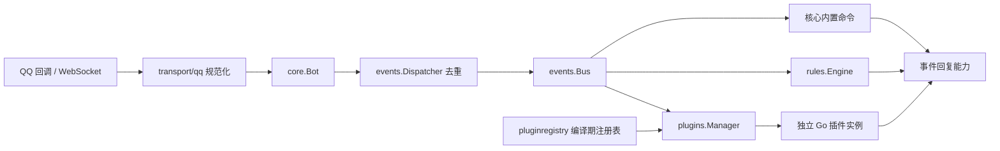

<div align="center">

# ShizukuBot

**Go 原生 QQ 官方机器人框架**

多机器人 · 编译期 Go 插件 · 可视化规则 · MDUI 2 管理后台

<p>
  
  
  
  
  
</p>

[插件仓库](https://github.com/kylin930/ShizukuBot-plugins) · [使用文档](docs/) · [插件开发](docs/plugin-development.md) · [QQ 接入](docs/qq-integration-guide.md) · [问题反馈](https://github.com/kylin930/ShizukuBot/issues)

</div>

## 简介

ShizukuBot 是一个用 Go 编写的 QQ 官方机器人框架。后端、插件与工具链统一使用 Go，不依赖 Node.js、npm 或前端构建步骤，生成注册表、编译、启动三步即可运行。

框架自带多机器人管理、签名 Webhook / WebSocket 接入、编译期 Go 插件、可视化规则、SQLite 统计、日志、调试沙盒与 MDUI 2 管理后台。现成插件见 [ShizukuBot-plugins](https://github.com/kylin930/ShizukuBot-plugins)（93 个，覆盖聊天、查询、游戏、整活、工具与群管）。

## 特性

| 能力 | 说明 |
| --- | --- |
| 多机器人 | 同一进程管理多个 QQ 官方机器人，独立配置、启停、插件启用与统计 |
| 双接入模式 | 默认签名 Webhook（`/webhook/{botID}`），显式配置后使用 WebSocket |
| Go 插件 | 编译期注册、进程内运行；Simple 构造器零样板，Advanced 保留完整生命周期 |
| 可视化规则 | WebUI 直接配置完全匹配 / 包含 / 前缀规则，改完立即生效，无需编译 |
| 管理后台 | MDUI 2 静态页面，覆盖统计、机器人、日志、调试、插件、规则、沙盒、配置、用户、关于 |
| 统计存储 | 纯 Go SQLite：收发计数、用户 / 群去重、DAU、小时与每日历史，跨重启恢复 |
| 外观设置 | 默认 / URL / 本地上传背景，动态主色，浅色 / 深色 / 跟随系统，登录页与管理后台共享 |
| 调试沙盒 | 为插件创建独立实例与临时状态，捕获回复与错误，不发送真实消息 |
| 安全 | 会话认证、CSRF 校验、日志 WebSocket 授权、凭证脱敏与原子配置写入 |
| 旧数据迁移 | 内置 `migrate-legacy`，备份旧数据并生成可审核的 Go 源码 |

## 架构



Bot 负责连接、生命周期与消息能力；Bus、Dispatcher 与 Transport 不依赖插件或流程图。插件通过 `shizukubot/sdk` 与宿主交互，`sdk` 只依赖标准库与公共事件类型。生产路径没有脚本解释器或动态代码加载。详见 [架构说明](docs/architecture-v2.md)。

## 快速开始

需要 Go **1.26+**（本轮验证 1.26.10）。后端与插件均只需要 Go 工具链。

```sh
go mod download
go build -o shizukubot .
./shizukubot
```

Windows 使用 `go build -o shizukubot.exe .`。

从仓库根目录运行，保留 `webui/`（页面模板与静态资源）；服务默认监听 `:4545`。

1. 首次启动会自动生成 `config/config.json` 与运行目录。
2. 浏览器打开 `http://localhost:4545`。
3. 初始管理员密码写入本机 `data/.admin-initial-password`（0600，不输出到日志），登录后请立即修改。
4. 在“机器人”页添加 Bot，填写 QQ 开放平台的 AppID / AppSecret 并选择接入模式。

QQ 凭证只保存在本机配置中。HTTPS 反向代理部署请设置 `webui.secure_cookies: true` 并保留正确的 Host；安全状态不直接取自代理协议头。管理后台不建议整体暴露到公网，详见 [QQ 接入指南](docs/qq-integration-guide.md)。

## QQ 官方接入

- 新 Bot 默认使用签名 Webhook：在 QQ 开放平台把回调地址填为 `https://你的域名/webhook/{botID}`，并配置 AppSecret。
- 显式配置 `websocket` 的 Bot 继续按 WebSocket 网关连接。
- 插件 SDK、内置命令与规则共用事件级被动回复上下文，携带原始 `msg_id`，并发安全分配 `msg_seq`（当前协议：C2C 最多 4 次，群聊 5 次；失败或超时也计入尝试）。
- 主动管理 API 不复用入站消息 ID，平台权限与限频错误会明确返回。

联调前可先离线检查配置：

```sh
go run ./cmd/qq-diagnose --bot 你的BotID
```

“机器人”页可展开 QQ 联调诊断；没有事件或回复证据时显示“暂无记录 / 未检测”。

> 仓库内的自动化测试均为 Mock 与离线协议回归。真实 Token、官方回调与客户端收信需要用自己的测试机器人验证；Mock 通过不等于真实平台验收通过。协议差异见 [审查记录](docs/qq-protocol-audit.md)。

## 管理后台

| 页面 | 路由 | 功能 |
| --- | --- | --- |
| 统计 | `/#/stats` | 收发计数、去重用户 / 群、DAU、小时与每日历史、保留期与清理 |
| 机器人 | `/#/bots` | Bot 增删改、启停、发送群 / C2C 消息、QQ 联调诊断 |
| 日志 | `/#/logs` | 实时日志 WebSocket 与历史日志 |
| 调试 | `/#/api-test` | 直接调用管理 API |
| 插件 | `/#/plugins` | 搜索筛选、Schema / JSON 配置、启停与重启、数据备份恢复 |
| 规则 | `/#/rules` | 规则增删改、草稿测试、启用 |
| 社区 | `/#/community` | 历史市场入口，仅兼容提示，旧包不会安装 |
| 沙盒 | `/#/sandbox` | 选择插件与 Bot、构造消息、捕获回复与错误 |
| 配置 | `/#/config` | 外观、统计策略、内置指令模板、Market API、原始 JSON 编辑 |
| 用户 | `/#/users` | 管理员账号与密码 |
| 关于 | `/#/about` | Core / WebUI 版本、Go 版本、系统、运行时间与依赖版本 |

页面使用静态分发的 MDUI 2，无需前端构建。配置表单与“保存原始配置”携带版本标识，其他管理员已修改时拒绝旧版本覆盖；密码与 AppSecret 不回填。用法见 [WebUI 设置](docs/webui-guide.md)。

## Go 插件

插件是普通 Go package，公共 API 在 `shizukubot/sdk`。最小 Ping 不需要结构体、工厂或空生命周期：

```go
package hello

import (
    "context"
    "shizukubot/sdk"
)

func Definition() sdk.Definition {
    return sdk.CommandPlugin(
        sdk.Meta{ID: "hello", Name: "Ping / Pong", Version: "1.0.0"},
        "ping", func(ctx context.Context, c sdk.Call) error {
            return c.Reply(ctx, "pong")
        },
    )
}
```

监听消息用 `sdk.EventPlugin`，多个指令或事件用 `sdk.Define`；需要资源初始化、后台任务与清理时使用完整 Extension 接口。Simple 与 Advanced 共用同一管理器、权限、实例 gate 与 EventBus。详见 [五分钟创建插件](docs/plugin-development.md) 与 [Go SDK](docs/plugin-sdk.md)。

仓库内置以下示例插件：

| 包 | 功能 |
| --- | --- |
| `plugins/hello` | CommandPlugin：`/ping` → `pong` |
| `plugins/autoreply` | EventPlugin：按 Bot 配置的关键词与回复 |
| `plugins/example` | Advanced：生命周期、配置与持久计数 |
| `plugins/framework` | `/framework` 说明型指令 |

插件默认不启用：在 WebUI 选择真实 Bot，用 Schema 表单保存配置后启用。配置、启停、重启与沙盒操作无需重新编译。新增插件：

```sh
# 1. 编写 plugins/<name>/plugin.go，导出 Definition() sdk.Definition
# 2. 生成注册表、测试并重新构建
go generate ./pluginregistry
go test ./sdk ./plugins/... ./pluginregistry
go build -o shizukubot .
```

源码变更必须重新生成注册表、构建并部署；仅点“重启插件”不会加载新代码。WebUI 只管理已编译插件，不上传源码安装运行。完整 93 个插件见 [插件仓库](https://github.com/kylin930/ShizukuBot-plugins)，安装方式与插件清单在该仓库 README 中说明。

## 无需编程的规则

进入 WebUI“规则”（`/#/rules`），选择真实 Bot，新建“包含 你好 → 回复 你好！”规则。新建默认禁用，可先测试草稿，再保存并启用；编辑、启停、删除立即作用于后续事件。

规则支持完全匹配、包含、前缀、群 / C2C 范围、优先级与安全文本占位符，走现有 EventBus、去重与回复能力。内置命令优先；规则与 Go 插件可以同时响应，同关键词的 autoreply 插件可能额外回复。规则测试只捕获预期结果，不发送 QQ，也不调用生产插件。操作、限额与版本冲突见 [规则指南](docs/rules-guide.md)。

## 统计与外观

收发计数、用户 / 群去重、DAU、小时与每日历史保存在 `data/stats.db`，跨重启恢复。默认保留最近 90 天，每天 Asia/Shanghai 03:00 清理；保留期与清理时间可在配置页修改并立即应用。

SQLite 驱动为纯 Go（`modernc.org/sqlite`），无需 CGO，Linux / Windows 只需 Go 工具链。备份需同时保存数据库与 `data/.stats-hmac-key`。

外观支持默认背景、HTTPS 图片 URL、本地图片上传，以及 MDUI 动态主色和浅色 / 深色 / 跟随系统。预览可取消，保存后服务器持久化，登录页与管理后台共享同一份设置。详见 [统计存储与口径](docs/statistics-storage.md)。

## 旧数据迁移

先停止旧程序并备份数据：

```sh
./shizukubot migrate-legacy --dry-run
./shizukubot migrate-legacy --apply
# 默认生成目录 plugins/migrated；检查备份、report.json 与生成源码后再注册构建
go generate ./pluginregistry
go build -o shizukubot .
```

原始 JSON 不删除。只有语义可证明的完整线性回复链会生成 Go 包；复杂图保留备份并报告人工迁移。生成源码不等于已安装、启用或完成部署。旧脚本目录不再加载，请离线保存原项目并人工改写为 Go；旧格式市场安装入口保持停用。详见 [旧数据迁移与回滚](docs/legacy-migration.md)。

## 目录结构

```text
ShizukuBot/
├── main.go            # 启动、优雅退出、migrate-legacy 入口
├── api/               # REST API 与路由
├── browser/           # 插件出图共享无头浏览器
├── cmd/               # qq-diagnose / plugin-registry / concurrency-test
├── config/            # 配置加载、保存与外观
├── core/              # Bot、事件分发、内置命令、统计、QQ 回复与诊断
├── docs/              # 使用、架构与交付报告
├── events/            # EventBus 与消息去重
├── migration/         # 旧数据迁移
├── pluginregistry/    # 编译期插件注册表（生成）
├── plugins/           # 插件与插件管理器
├── rules/             # 轻量规则引擎
├── sdk/               # 插件 SDK
├── server/            # 历史插件市场服务（独立 Go 模块）
├── storage/stats/     # SQLite 统计存储
├── transport/qq/      # QQ 事件规范化与网关
├── webhook/           # 签名 Webhook
├── webui/             # MDUI 2 管理后台（模板、静态资源、认证）
└── config/config.json # 首次运行自动生成（含凭证，已忽略）
```

运行期目录：`data/`（统计库、插件状态、规则、上传背景、初始密码）、`logs/`（日志）。

## 开发与验证

```sh
go test ./...
go test -race ./...
go vet ./...
go build ./...

# 独立 QQ HTTP 请求协议回归，不需要凭证
go test ./core ./webhook ./transport/qq -run 'TestQQ|TestWebhook|TestSigned|TestGateway'

# 无 CGO 交叉编译
CGO_ENABLED=0 GOOS=windows GOARCH=amd64 go build -o shizukubot.exe .
CGO_ENABLED=0 GOOS=linux GOARCH=amd64 go build -o shizukubot .
```

## 文档

| 文档 | 内容 |
| --- | --- |
| [架构说明](docs/architecture-v2.md) | 事件链路、生命周期、路由并发、配置与安全边界 |
| [插件开发](docs/plugin-development.md) | 五分钟创建插件、事件、配置、状态与测试 |
| [Go SDK](docs/plugin-sdk.md) | 插件 API 与能力清单 |
| [插件管理与沙盒](docs/webui-plugin-management.md) | 插件页操作、备份与沙盒 |
| [规则指南](docs/rules-guide.md) | 规则语法、测试、限额与冲突 |
| [WebUI 设置](docs/webui-guide.md) | 统计策略、外观、保存与版本冲突 |
| [统计存储与口径](docs/statistics-storage.md) | 数据库结构、备份与统计口径 |
| [QQ 接入指南](docs/qq-integration-guide.md) | HTTPS、签名、测试成员与权限 |
| [QQ 协议审查](docs/qq-protocol-audit.md) | 协议版本与实现差异 |
| [旧数据迁移](docs/legacy-migration.md) | 检测、迁移、审核与回滚 |

交付报告（P0–P2.5）保留在 `docs/v2-*.md`，包括 Go 纠偏、SDK 开发体验、插件后台、规则、QQ 联调、SDK 统一维护、WebUI 打磨与统计 / 外观。

## 已知限制

- **同进程插件不是安全隔离**：可信插件仍可访问文件、网络、进程与 `os.Exit`；不要自动编译执行任何上传源码。
- **没有视频发送与戳一戳能力**：回复支持文本、图片、语音、Markdown、按钮和 @ 用户。
- **没有后台调度 API**：依赖定时推送的插件需要宿主提供调度能力。
- **旧脚本插件不再加载**：`data/code-plugins` 等目录仅保留数据，不扫描执行。
- **QQ 频道 / 私信仅支持文本**：群聊与 C2C 支持框架已有的媒体能力。
- **真实平台验收需要自测**：仓库测试不覆盖真实 QQ 凭证与客户端收信。

## 许可证

[Apache License 2.0](LICENSE)
