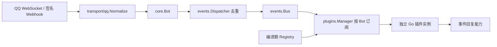

# ShizukuBot v2 架构：Go 原生 P1.2

## 生产事件链路

Bot 管理连接、生命周期和消息能力。Bus、Dispatcher 和 Transport 不依赖插件、图模型或编辑器。P0 的来源规范化、按 Bot/消息身份去重、签名、gateway 取消/重连和管理安全保留。生产路径没有 LiteGraph、Yaegi、脚本宿主或动态代码加载。

## SDK 与运行时边界

插件实现 → `sdk` ← `plugins` 原生适配器/管理器 → EventBus。

`sdk` 只依赖公共事件类型与标准库，包含 Meta/Manifest、Definition、Extension/Base、Host/Registrar、Call/State、Schema 和 Simple 构造器。它不依赖 Registry、Manager、QQ SDK 或静态注册方式。`events.Event` 通过类型别名供 SDK 使用，不复制事件字段。当前 `plugins.Native` 仍是同进程 Go 适配器，不为未来 RPC/IPC 预造运行时。

CommandPlugin、EventPlugin、Define 生成普通 Extension：每个 New 返回新对象，Load 通过原 Host 注册；与 Advanced 共用 Native/Manager 的生命周期、权限、实例 gate、错误处理和 Bus。Simple 默认只给对应注册和回复能力，额外配置/状态/日志显式声明。Define 的注册回调在每个实例执行，回调返回后 Registrar 封闭；注册错误不能被忽略成成功。传入处理函数的外部可变闭包仍由作者负责，需实例状态时在 Define 回调内部构造或使用 Advanced。

旧 `plugins` 公共类型是 sdk 的 deprecated 别名，只有一份模型；配置 JSON、持久状态、事件规范化和 WebUI API 不变。普通插件不需要导入实现包。

`plugins.Registry` 是唯一插件目录。sdk.Definition 包含版本化 Manifest 和返回全新 Extension 的构造函数；拒绝重复 ID、无效 schema/权限和非 Go runtime。Manager 取得不可变快照，后续 Registry 注册不改变正在运行的目录。元数据会深拷贝，不能通过外部修改共享 schema。

`pluginregistry/generated.go` 静态导入经审查的 `plugins/**` Go 包。`go generate ./pluginregistry` 只解析源码、生成 import 和注册调用，不执行插件；编译、测试和部署是显式动作。普通 Go build 不隐式执行 generator，生成文件提交进仓库。外部嵌入者也可手工创建 Registry 后传入 Manager。

## 生命周期、路由与并发

每个插件/Bot 拥有独立对象、配置快照、状态文件和长期 context。生命周期为 Load → Start → 事件调用 → Stop → Unload；Load/Start 中通过 Host.Command/On 注册，Start 返回后封闭。失败初始化也会取消生命周期并执行清理。Host.Context 用于后台任务，不应使用短期初始化 context。

同实例初始化、事件和停止通过可取消 gate 串行；不同实例可并行。Disable/Close 先取消 context、取消订阅，再等待在途调用并清理；重复 Enable 不创建重复实例/订阅。Bot 的连接与插件启用独立，Bot 重连复用订阅，停止 Bot 后不再产生事件；需要释放插件资源时禁用插件。框架关闭统一清理。

Bus 按订阅顺序同步广播。多个插件可响应同一普通指令；一个实例的指令回调、匹配事件回调及 HandleEvent 均可执行。核心已处理的内置命令通过纯路由策略跳过插件，沙盒只测试插件。命令默认 `/` 前缀、支持引号和转义，其他前缀可用事件回调。

调用默认 2 秒，**Go 超时是合作取消**，不强行杀死 goroutine。回调的 error/panic 会记录到状态并返回，其他回调和订阅继续执行；后续调用允许恢复，管理员也可重启实例。框架不再采用进程崩溃重建或 IPC 退避机制。后台 goroutine 必须自行 recover/同步、遵守 context 并在 Stop 中等待释放。

管理 API 配置锁只保护快照和提交，同 Bot 生命周期编辑单独串行；查询、沙盒和消息发送不持全局锁。核心认证、内置回复和网络发送仍保持 P1 已有的锁外调用与 context 传播。

## 配置、状态与备份

`data/plugin-data/settings.json` 保存按插件/Bot 的 enabled/config；`state/<id>/<sha256(botID)>.json` 保存状态。配置 schema、原子写入和磁盘状态限额保留。配置更新后重启实例生效，无需重新编译；WebUI 保存会为已启用实例执行重启。状态不会因重启或禁用丢失。

数据备份只含版本、插件 ID、各 Bot 配置与状态，不含源码、激活标记或核心凭证。只允许恢复到已编译插件的空数据 scope，拒绝覆盖已有数据，保持禁用。备份是各状态文件的有效快照，不承诺跨 Bot 事务一致性，严格一致备份应停止主机。私有备份需保密。

原 P1 的 `data/code-plugins` 及用户旧图数据保留在磁盘，不扫描、不加载、不删除。未知旧脚本 ID 的配置不恢复执行；同 ID 的新 Go 定义需人工核对配置和状态兼容性。旧格式 trusted 字段不再控制编译代码，已知 Go 插件仍按 enabled 恢复。

## 能力与安全边界

sdk.Host 提供 BotID、配置快照、状态、日志、生命周期和注册；Call 提供规范 Event、参数、Config、State、Log、Reply/Send。主机检查事件/命令/发送/配置/状态/日志权限，回复绑定当前事件来源，不暴露 QQ 客户端、AppSecret 或其他 Bot 的 sender。

这些能力约束是 SDK 使用契约，**同进程 Go 代码不是安全隔离**：可信插件仍可自行访问文件/网络、启动进程、调用 os.Exit 或耗尽资源，独立 goroutine panic 无法由外层回调 recover 捕获。禁止把任意上传源码自动编译执行，未实现 `.so`、解释器或进程外协议。当前无需模拟动态脚本体系。

沙盒每次创建独立 Go 实例、临时状态和捕获型 Reply，最多并发四个；不复用生产 sender、状态或订阅。它可验证回复和错误，不限制插件自行产生的副作用。

认证、CSRF、HTTPS Cookie 策略、日志 WebSocket 授权和凭证脱敏沿用 P0。WebUI 继续使用 MDUI 2 的普通浏览器 JavaScript，静态分发，无后端 Node 依赖。旧图只在离线迁移工具读取，详见 [迁移说明](legacy-migration.md)。P1.2 验证与兼容说明见 [SDK 开发体验报告](v2-p1-sdk-dx-report.md)，原 Go 纠偏记录保留为历史。
