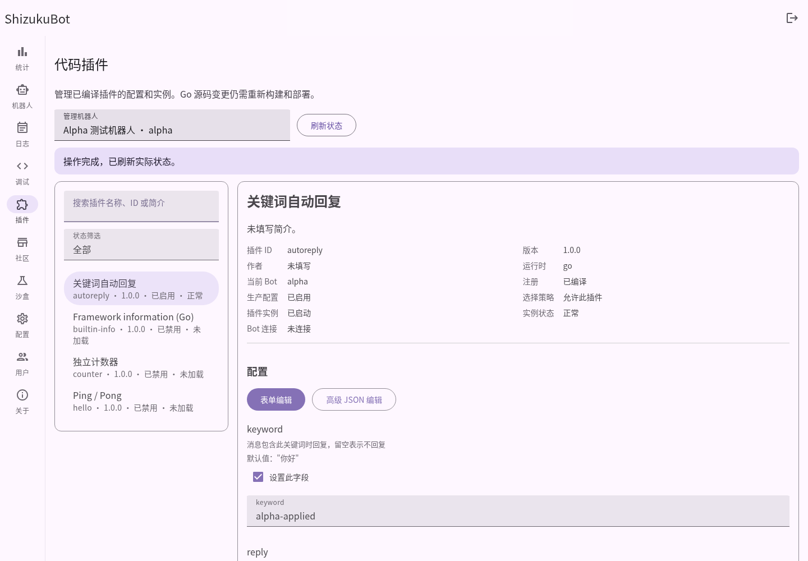
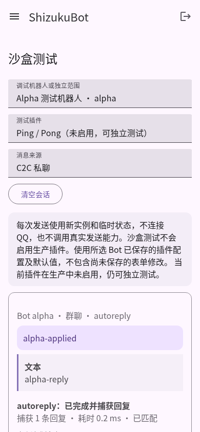

# P2.1 插件管理与沙盒交付报告

## 基线、提交与边界

开始时工作区干净，当前分支为已推送的 P1.2 `feat/v2-p1-sdk-dx`（`b744110`）。fetch 确认 main 仍为 `9cf1e69`，尚不包含 P1.2，因此从远程 SDK 分支创建 `feat/v2-p2-plugin-ui`，保留所有原提交和用户数据。只推送独立分支，不合并或推送 main。

按要求分步提交：

| 阶段 | 提交 | 内容 |
| --- | --- | --- |
| A | `f4f2f75` | SDK 遗留、真实 Bot 范围、状态与配置应用、备份配额、调试事实 |
| B | `384762c` | 插件搜索、Bot 选择、详情与独立页面代码 |
| C | `0beb12a` | Schema 表单与保留数据的 JSON 编辑 |
| D | `ad5fed8` | 独立沙盒页面、六种结构化结果、精确执行状态 |
| E | 本报告所在提交 | 浏览器发现的问题、完整回归、文档与真实截图 |

保留 MDUI 2、原配色、App Bar、桌面 Rail、手机 Drawer 和既有 hash 页面路径。没有新增前端框架、npm 构建、Go module 路径变更、插件市场、热加载、独立进程、规则引擎或流程图。

## 页面与状态流转

`/#/plugins` 从真实 `/api/bots` 列表选择 Bot，默认使用已有选择或第一个实际 Bot。没有 Bot 时只读编译目录；后端也拒绝不存在 Bot 的正式管理操作，不以控件选项代替安全校验。

插件列表展示名称、ID、版本、简介和当前 Bot 状态，支持搜索及启用/禁用/异常/策略排除/实例启动筛选。详情按概览、配置、运行、错误和可展开高级信息组织，不再在主界面打印整个状态数组。

状态明确拆分：compiled（编译注册）、enabled（该 Bot 的保存启用设置）、allowed（选择策略）、running（活动插件实例）、state/last_error（实例状态）、bot_running（核心连接）。活动实例发生回调错误后仍可能运行，不能只用一个布尔值推断健康或是否连接 QQ。

配置、启停和重启绑定所选 Bot。启用/重启尊重允许列表，禁用始终可释放旧实例。保存后应用只调用现有 Manager.Restart，校验失败不更改配置或运行实例；保存成功、应用失败和状态刷新失败分别反馈。有效配置未变化不重复重启。“重启插件实例”明确不重新读取 Go 源码。

新普通 JS 文件：

- `plugin-common.js`：安全 DOM、请求、页面作用域、未保存保护、操作锁定。
- `plugins-page.js`：真实 Bot、搜索筛选、详情和数据操作。
- `plugin-schema.js`：通用配置编辑及前端校验。
- `sandbox-page.js`：沙盒选择、会话、回复与执行事实。

index.html 实际加载这些文件，沿用 Go 静态服务，无打包步骤。app.js 只保留原路由并调用独立页面；增加最小的离开保护/清理，保留其他页面。离开时取消请求和作用域监听器；同页切换以请求版本防止旧响应覆盖。操作期间禁用交互并锁定内容，控制重复提交。减少动态效果设置得到尊重。

## Schema 表单

| Schema | 支持 |
| --- | --- |
| string | MDUI 文本框 |
| boolean | MDUI Switch，false 是有效值 |
| integer / number | 数值框，整数/有限值/minimum/maximum 校验 |
| enum | MDUI Select，保持原 JSON 值类型 |
| object | 嵌套分组、必填和可选字段 |
| array | 基础类型及对象等项目的增删、items 校验 |
| required/default/description | 名称、必填标记、默认值、字段描述及缺失校验 |
| 未知/不可靠结构 | 保留完整原 JSON，切换高级模式，禁止静默删除 |

Schema 增加可选 description，现有配置数据及版本不变。数组后端错误增加索引，前端错误给出具体字段路径。最终校验仍在 Go 中完成，前端不能绕过。

草稿与初始配置深拷贝，渲染不修改原对象。表单/JSON 共用数据；JSON 或数值无效时不允许通过切换或结构操作悄悄丢弃。可选字段能表达“未设置”，后端按既有默认值规则补全。未知字段、null、不支持类型或超出容量时使用 JSON。

表单展开上限为 8 层、单数组 100 项、约 500 个结构节点，较大结构可继续用 JSON；不声称实现完整 JSON Schema。没有配置的插件显示无需配置。Bot、插件、页面切换和重置会处理未保存修改。没有硬编码 hello/autoreply/counter 的字段。

## API 与 SDK 的兼容扩展

旧路径、API envelope、插件 JSON 字段和 Sandbox replies/results/errors/executions 保留。

- 列表/详情 bot_id 校验真实 Bot；PluginInfo 增加独立状态字段、有效配置和配置错误。
- PUT `/api/plugins/{id}` 增加可选 apply（默认 false），返回 saved/applied/restart_required，应用失败另有 restart_error。旧显式重启客户端仍可使用。
- toggle/restart/配置/恢复要求真实 Bot；启用和重启检查选择策略。同插件/Bot 管理变更串行，查询不持全局生命周期锁。
- Manager 增加 NeedsRestart 比较保存配置与活动快照；没有重写生命周期管理。
- Debug 原 error-only 方法保留，增加 DebugWithResult 报告 MatchKnown/Matched；不以空回复推断未匹配。
- ExecutionResult 保留 completed/failed，增加 outcome、matched、reply_count、duration_ms；超时/取消由真实错误链判断，耗时实际测量。
- Sandbox 增加 independent 和 configuration_source。独立模式使用默认配置，不读取生产启用列表；真实 Bot 的“全部”只测试启用且策略允许的插件。显式选择的编译插件即使未启用也可测试。
- EventPlugin 按首次出现顺序去重；保留自定义事件，拒绝空、超长、非 UTF-8、空白/控制字符名称。
- 备份恢复与导出共享 4 MiB 配额；安全中间件只为精确的恢复 POST 路径放宽至 4 MiB，其他请求保持 2 MiB。边界和失败保留已有数据均有测试。

恢复不是源码安装。旧插件安装/卸载仍为 410，图与源码转换路径仍为 404。SDK API major 不变，没有新增第三方 Go 依赖。

## 沙盒与安全处理

沙盒可选择真实 Bot 或明确标记的独立标识、插件及群/C2C 来源，从插件详情带入选择。每次新实例和临时状态，回复能力只捕获数据，不复用真实 sender、生产状态或连接。真实范围使用已保存配置，独立范围使用默认值，未保存的表单草稿不会暗中传入调试。

结构化展示 text、markdown、image、rich_media、keyboard、video：文本使用 textContent，Markdown/按钮只展示源文本，媒体不自动请求资源，只提供经过协议和凭证检查的 HTTP(S) 链接或原文。未知类型保留类型和必要信息。所有动态名字、错误、日志文本、配置和值经安全 DOM 操作，未将原始字符串作为 HTML 或内联 JS。长错误可展开，媒体长链接提示截断并允许展开。

结果区分匹配后无回复、未匹配、回复、失败、超时和取消；旧服务未提供匹配事实时明确说明。会话最多保留 100 次执行。最近错误来自实际实例状态，没有新增伪日志或大型观测服务。

现有管理员认证、CSRF、Cookie 和日志 WS 授权保持。后端不信任前端 Bot 下拉选择；核心凭证没有进入插件表单或沙盒响应。原生可信插件仍可自行访问 OS，功能沙盒不等于安全隔离。

## P1.2 遗留与浏览器修复

1. EventPlugin 重复事件已规范化，首出现顺序和非法类型有单元测试。
2. 恢复配额不再被全局 2 MiB 限制提前截断；4 MiB、4 MiB+1 和普通请求边界已测，失败不覆盖配置/状态。
3. saveConfig 原先构造 enabled=false。实际审查发现全局配置 API 不应用 bots 数组，因此之前未实际禁用 Bot，但载荷和页面数据会失真。现改为保留原 enabled 及其他 Bot 字段；GetConfig 使用完整且脱敏的 botInfo，保持 mode/插件列表等字段。没有重写 Bot 编辑逻辑或开始让全局配置接口替换机器人。
4. 实际 Chromium 回归发现 MDUI 在已排队状态更新后立即卸载输入控件会访问失效引用。保存刷新不再先更新将被移除的旧控件；可选字段先同步草稿、等待 MDUI 完成本次更新再重建。没有忽略浏览器异常，最终保持零未处理错误断言。
5. 操作恢复 disabled 时仅恢复本次锁定的控件，避免覆盖新详情中的策略禁用状态；页面切换取消时同步原导航选中状态。

## 实际验证

Linux amd64，Go 1.26.10。先执行 sdk/plugins/api/webui 定向验证，再完成以下检查：

| 检查 | 实际结果 |
| --- | --- |
| `go test -count=1 -json ./...` | **80 项顶层测试通过，0 失败、0 测试跳过** |
| `go test -race -count=1 -json ./...` | **80 项通过，无 race 报告** |
| `go vet ./...` | 通过 |
| `go build ./...` | 通过 |
| Windows amd64，CGO_ENABLED=0 主程序构建 | 交叉构建通过，未声明 Windows 实机运行 |
| API/SDK 新回归 | 真实 Bot/策略、配置校验和重启状态、超时/未匹配/无回复、备份配额和保留数据、独立调试及 enabled 回归通过 |
| 原 P0/P1/P1.2 | 事件隔离、去重、生命周期、状态/配置、认证/CSRF/WS 等原断言保留并通过 |
| JS 语法、Python 脚本语法、gofmt、git diff --check | 通过；Node 仅用于可选语法检查，不是构建/运行依赖 |
| 真实浏览器 | 安装的 Chromium + Python Playwright，1440×1000 桌面和 390×844 手机宽度；实际 MDUI 组件加载通过，无横向溢出、无未处理页面错误 |
| 浏览器实际流程 | 列表、Bot 隔离、表单保存/应用、JSON 往返、未保存保护、旧响应延迟竞态、选择策略、启停、详情进入沙盒、群/C2C、未启用插件和临时状态通过 |
| 浏览器明确标记的夹具 | 全 Schema 类型、数组/可选项、required/enum/数值校验、未知数据保留、六种回复、元数据/错误/Markdown/链接 XSS、重启失败反馈、空 Bot、403 和 enabled 序列化通过 |
| 实际 HTTP 冒烟 | 启动、登录、静态资源、脱敏、退役路由 404、正常退出通过；10 并发 **100 请求全部成功** |

浏览器先前发现的真实组件错误和测试夹具挂载时序均已定位修复，保留零错误及数据校验断言，没有将失败当成功。截图只拍摄真实主程序和禁用连接的 mock Bot；Schema/错误响应/XSS 的合成夹具单独执行，未用它们伪造运行截图。

机器可读 Go 日志：`/tmp/shizuku-p2-tests.json`、`/tmp/shizuku-p2-race.json`。HTTP 冒烟临时目录 `/tmp/shizuku-p0-d1au23mv` 及浏览器脚本输出的私有数据目录包含本机随机测试凭据，不上传 Git。

复现命令：

```sh
go test ./...
go test -race ./...
go vet ./...
go build ./...
CGO_ENABLED=0 GOOS=windows GOARCH=amd64 go build -o /tmp/shizukubot-p2.exe .
go build -o /tmp/shizukubot-p2 .
# 可选：测试工具需 Python Playwright 与 Chromium，后端和前端部署不需要它们。
python3 scripts/p2-browser-smoke.py --binary /tmp/shizukubot-p2
# 可选：已有 HTTP 并发回归。
go build -o /tmp/shizuku-p2-http ./cmd/concurrency-test
python3 scripts/p0-smoke.py --binary /tmp/shizukubot-p2 --runner /tmp/shizuku-p2-http
```

### 实际运行截图

桌面插件页：[原图](images/p2-1/desktop-plugins.png)。手机插件详情为真实滚动位置：[原图](images/p2-1/mobile-plugins.png)。



桌面沙盒：[原图](images/p2-1/desktop-sandbox.png)。手机沙盒：[原图](images/p2-1/mobile-sandbox.png)。截图中的回复与毫秒耗时来自实际请求。



## 使用与尚未覆盖的范围

操作步骤见 [插件管理与沙盒](webui-plugin-management.md)：选择真实 Bot → 搜索插件 → 查看独立状态 → 表单编辑 → 保存并应用 → 启停/重启 → 进入沙盒查看回复和事实，无需终端或重启主程序。

已知边界：

- 未连接真实 QQ、验证平台授权媒体、生产 HTTPS 或真实手机/Windows 运行；手机检查是 Chromium 视口，图片/视频是安全结构化信息，不是 QQ 客户端渲染器。
- Go 插件同进程可信运行，超时是合作取消；不合作代码、插件自己联网/文件操作和独立 goroutine panic 不由该功能沙盒隔离。
- 未实现完整 JSON Schema、密码字段专用 schema、跨 Bot 事务或配置版本冲突合并；编辑期间的外部配置修改需刷新后处理。
- 数据恢复仍要求空数据范围且 Bot 存在，不做危险覆盖；备份含插件私有数据，严格一致离线备份仍应停主机。
- 日志使用现有 LastError/日志服务，没有新增插件日志平台或完整 RBAC。
- 热加载、在线编译、Supervisor、独立进程、规则编辑器和市场自动安装明确延期到后续阶段，没有本轮可用承诺。
