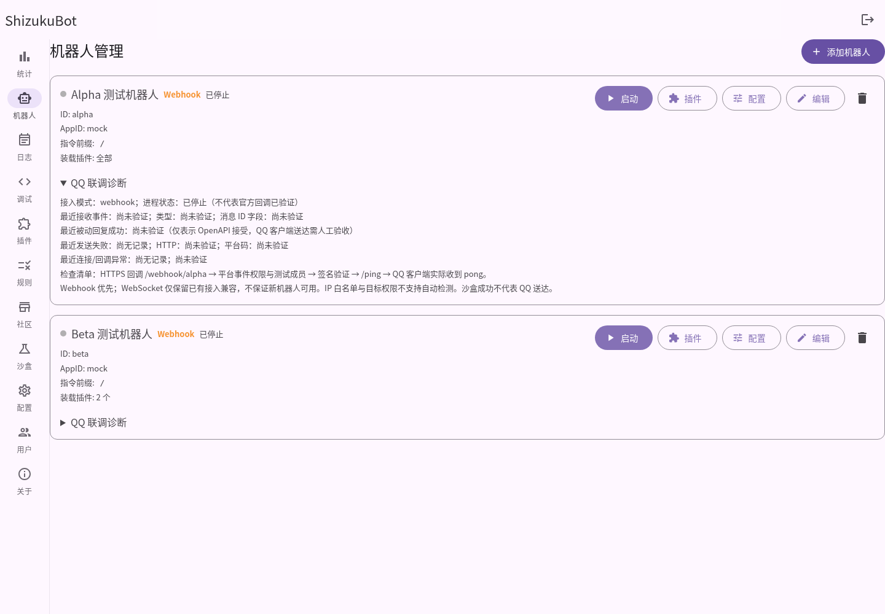
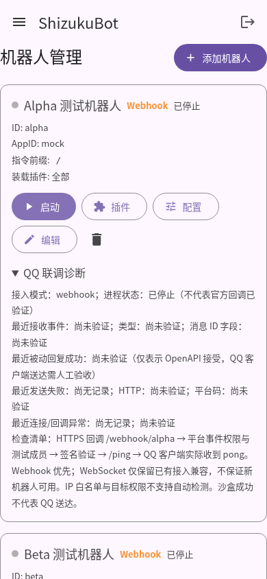

# P2.3 QQ 官方协议修复与联调交付报告

> 历史实现说明：本文件保留当时的 SDK 路径与验证事实。当前编译依赖已迁移到独立 botgo-plus，根目录 botgo-master 已移除；见 [P2.3.1 迁移报告](v2-p23-botgo-plus-migration-report.md)。


日期：2026-11-02。工作分支：`feat/v2-p2-qq-integration`。

**阶段 A 的本地自动验证通过；阶段 B 的工具、诊断和验收流程已交付，真实 QQ 联调未执行。**
环境没有真实 AppID/AppSecret、测试成员/群授权或已部署的官方 HTTPS 回调。
没有向真实 QQ 用户发送消息；未将 Mock 结果当作平台实测。

## 基线、协议来源与版本结论

工作前 fetch origin，确认远程 main 为 `fc4db97`，包含 P2.2 PR #3 merge。
从该提交建立独立分支；本地原工作分支干净，未修改 main。
审查 core、transport、webhook、events、api、plugins、rules、config 和 vendored SDK。
Go module 仍是 `github.com/tencent-connect/botgo v0.14.0 => ./botgo-master`，没有整体升级 SDK。

[协议审查记录](qq-protocol-audit.md) 链接了实际读取的 Tencent 官网页面、
GitHub bot-docs `645787a` 和官方 botgo `fe31c0d`，并记录路径与兼容性取舍。
重要差异：

- 最新官网 C2C 上限 **4 次**，群聊 **5 次**；GitHub 旧文档 C2C 5 次不能直接沿用。
- 最新官网列出主动发送权限与频控，旧 GitHub 有 2025-04-21 停用通知。保留显式主动发送，不假设所有应用都有权限，也不伪造被动 ID。
- C2C 时效：官网介绍 60 分钟，字段说明仍为 5 分钟。只提供事件处理期内立即回复，不实现延迟复用，实际时效由平台决定。
- WebSocket：GitHub 历史停用通知与当前官网保留协议文档有差异。代码兼容与权限/政策可用性分开报告，新配置默认 Webhook。

## 回复链路与 SDK 修复

`Webhook / Gateway → Bot.HandlePayloadAccepted → Normalize → 现有 Dispatcher（去重）→ 同一 Bus → 内置命令 / Go 插件 / 规则 → Event.Reply → BotGo HTTP`。

事件闭包只捕获 Bot 路由、来源、目标、message/event ID、取消信号和一个 mutex 计数器，
不保留原始正文和 Raw。不同事件独立计数；同一闭包供多个订阅者使用，线程安全。
C2C 最多分配 1..4，群聊 1..5。序号在最终 POST 前分配，不在上传阶段消耗；
失败/超时/断线不退还序号，不自动重放。闭包与事件处理生命周期绑定，处理结束后
即使插件保留闭包、换用 Background context 也会拒绝发送。没有全局“最近消息”变量或消息序号 Map。

C2C 使用 author.user_openid，群聊使用 group_openid/author.member_openid，
频道继续使用 author.id；消息 d.id 与 envelope.id 分开。支持的管理事件仅按文档
白名单使用 event_id；INTERACTION_CREATE 不推断目标，不把 d.id 当 message ID。
现有多 Bot、相同消息跨 Gateway/回调的去重继续使用原 Dispatcher。

SDK/发送侧的窄范围兼容修复：

- 显式序列化文本 `msg_type:0`；Markdown 用 type 2 和 markdown 对象，省略互斥 content；按钮为 keyboard 对象。
- URL/base64 图片、图文、视频统一 `/files` 上传，`srv_send_msg:false`，然后 type 7 `/messages` 携带 file_info 和当前关联/序号。
- 保留 file_info 原始 opaque 字符串，不要求其一定为 base64。SDK 仍保留旧 []byte 公共字段，新增 FileInfoRaw 以兼容调用方。
- 同时兼容历史整数时间戳和当前官网 RFC3339 返回格式；上传缺少 file_info、发送缺少消息 ID 均不能误报成功。
- SDK 请求级授权字段代替共享 client token 修改；TraceID getter 加锁，错误自带请求级 trace，避免并发串联。
- 同时检查 HTTP 与 code/err_code，包括 HTTP 200 的业务失败。11244 使缓存 Token 失效，供**下一次调用**刷新，不重放当前 POST。
- public SendGroup*/SendC2C* 签名保留，为明确主动发送；管理 HTTP 增加兼容 Context 变体以传递请求取消。无 msg_id/event_id/msg_seq，不借用其他消息，平台错误通过既有 JSON API 返回业务 code=502 和脱敏原因。

SDK 的 Reply/ReplyMarkdown/ReplyImage 等继续走现有 Event.Reply；未扩展 sdk.Call，
未改变规则匹配逻辑、插件运行时或 EventBus，没有引入第二个 Dispatcher。

## Mock OpenAPI 与集成断言

`core/qq_protocol_test.go` 使用 httptest.Server、真实 vendored BotGo、
静态 TokenSource 和实例级 WithBaseURL 注入。不是只检查 DTO，也没有新建假 QQ SDK。
Mock 捕获最终 HTTP Method、完整路径、AppID 路由和 JSON 正文，返回真实形状的上传/发送响应。

| 验收项 | 自动化结果 |
| --- | --- |
| C2C /ping → pong | 真实插件管理器 + hello，POST /v2/users/user/messages，type 0、原 msg_id、seq 1/2 校验通过 |
| 群 /ping，含 GROUP_MESSAGE_CREATE | 原群 /v2/groups/group/messages，无跨命名空间目标，校验通过 |
| 规则关键词回复与即时更新 | 同一 Bus 的真实规则 Engine，保存后新消息立即用新文本，不重连，通过 |
| 同一消息多个处理器 | hello 与规则共用闭包、不同 seq，通过 |
| 并发回复/上限 | 20 个 goroutine：群仅 5 个实际发送、其余限额错误，seq 唯一；C2C 单独验证 4 次上限，通过 |
| 不同消息 / Bot | 独立 seq 从 1 开始；HTTP AppID、目标、msg_id 隔离，通过 |
| 401 / 429 / 未知码 / 403 | 返回结构化 HTTP/业务错误，未知原因不硬归类，通过 |
| HTTP 200 + 非零业务码 | 明确失败，通过 |
| 超时与断线 | 请求次数受控、无自动重试；下一次显式回复用新 seq，通过 |
| HTTP 取消 | context 取消终止真实 HTTP，Bot 生命周期取消仍有效，通过 |
| 重复事件 | 同消息只发布一次；签名回调重复不再次 POST，通过 |
| 缺少消息 ID | 不以 event_id 补造消息 reply，不产生 POST，通过 |
| event_id | 仅四种支持管理事件使用 envelope ID，通过 |
| text/markdown/keyboard/image/rich_media/video/base64 | 校验 type、对象、上传路径/file_type、明确 srv_send_msg:false、原样 file_info，通过 |
| 无效成功响应 | 缺少 file_info / 发送消息 ID 不报成功，通过 |
| 明确主动发送 | 不携带关联 ID/seq，媒体先上传，Bot 停止时明确失败，通过 |
| 上下文释放 | 保留旧闭包也不能在事件取消后发送；新上下文不继承计数，通过 |

`webhook/webhook_test.go` 另外覆盖签名回调到真实 SDK HTTP 的完整链路，
校验签名、原始 body、消息 ID、type、seq、正文、目标，以及重复回调去重。
API 测试确保真实诊断不泄露 Secret，停止 Bot 手动发送明确失败，沙盒不污染 QQ 成功状态。

## Webhook 与 Gateway

Webhook 保留 `/webhook/{botID}`，POST、2 MiB 原始 body 上限、按 URL Bot 的 Secret
进行 Ed25519 校验。补上缺少签名时间戳必须失败的 SDK 修复。测试覆盖：

- 正确签名和 chunked body；错误 Secret、篡改 body、无签名/无 timestamp。
- Bot 不存在、不同 Bot 回调隔离、错误 JSON/data、超大 body、未知 opcode。
- op13 plain_token/event_ts 签名响应，用验证函数再次校验响应；heartbeat ACK。
- 处理器报错但已接收时 op12 d=0，避免无意义重投；停止 Bot 时 d=1，可重试。
- 回调工作 context 10 秒协作超时，与 Bot.Stop 联动取消。

Gateway 保留 Discover、Token、Identify、Heartbeat、Reconnect、Resume、Seq、Shard
与关闭流程；补充握手读超时、服务端主动 Heartbeat、fatal 关闭码和处理后的 Seq 保存。
本地 WebSocket Mock 验证 Identify Token/single-shard、周期与服务端心跳、ACK、
Reconnect/Resume 的 session/seq/裸 token、重复事件去重、取消及 worker 回收。
多分片调度代码经过审查，但未做真实多分片或官方 Gateway 验证。

## 脱敏日志与诊断

保留 core 的 safe SDK logger，SDK 不再格式化输出消息请求/响应和 Token/Secret。
Core 发送日志仅含 Bot 日志域、mode、source、kind、成功或类别；失败提供 HTTP 状态、
业务码和有界 trace，未知 SDK/网络错误被固定文案替换。无原始事件、完整聊天正文、
图片 data URL、Secret、Token 或 Authorization Header。日志/统计接口兼容。

每 Bot 一个 mutex 保护的最新诊断快照，包含事件时间/类型/ID 是否存在、
最近**被动**回复接受时间、最近失败时间/类别/HTTP/平台码/trace 和最近 transport
异常。不是事件历史，不跨 Bot 保存，不持久化聊天，重启后未验证。
主动发送成功不会更新被动回复时间；后续成功不擦除最近失败的原因及元数据。

现有 MDUI Bot 卡片内 `<details>` 展示诊断，不修改整体布局。
运行状态不代表官方回调已连通，OpenAPI 成功不代表 QQ 客户端收信，缺失证据显示
“尚未验证”，IP 白名单/目标权限标为不能自动检测。
AppSecret 输入不回填，编辑留空保留原值；新建默认 Webhook，原显式模式保持兼容。

实际本地测试数据（mock Bot，未连接 QQ）截图：





## 真实联调准备与当前状态

[完整接入/验收指南](qq-integration-guide.md) 提供平台建 Bot、测试成员、凭证、
只读 Secret、本地 0600 配置、HTTPS 反向代理、事件权限、IP 白名单、启用插件、
回调诊断和 B1–B6 人工验收表。默认管理后台仅本机访问；仅暴露 Webhook 路径。
.gitignore 覆盖本地凭证、token 缓存和测试记录。没有真实凭证提交。

`cmd/qq-diagnose` 默认只读本地文件，不访问 QQ、不保存配置。`--live-auth` 才实际
认证指定的自有测试 Bot，工具永远不发送消息；退出码和无条件时的未执行原因均有文档。
live 认证不自动判定回调或客户端送达。

| 验证类型 | 结果 |
| --- | --- |
| 事件规范化、Mock OpenAPI、签名、插件/规则集成 | 通过（本地） |
| 真正 QQ Token 正确/错误/过期恢复 | 未执行：无真实凭证 |
| 官方平台 op13 验证及消息回调 | 未执行：无部署/平台配置 |
| QQ 客户端 C2C /ping、规则、共存、多次回复 | 未执行：无已授权测试环境 |
| 真实群聊权限与跨群隔离 | 未具备测试条件：无群/账号授权信息 |
| 真实断网/平台超时、停止/重启恢复 | 未执行；仅完成本地自动化支持 |
| 真实 WebSocket 接入、多个 shard、平台政策资格 | 未验证；不作可用承诺 |

## 构建、回归与复现

Go 1.26.10，Linux amd64。本轮实际执行并通过：

```sh
go test ./...
go test -race ./...
go vet ./...
go build ./...
CGO_ENABLED=0 GOOS=windows GOARCH=amd64 go build ./...
# 独立协议组
go test ./core ./webhook ./transport/qq -run 'TestQQ|TestWebhook|TestSigned|TestGateway'
# 变更的 SDK 模块额外检查（不跑需要 Redis 的历史测试）
(cd botgo-master && go test ./dto ./errs ./openapi/v1 ./token ./interaction/signature ./interaction/webhook)
```

工具链通过 `/workspace/.tools/go1.26.10/bin` 选择；本机 `/usr/bin/go` 并非正确的 Go 工具。
只读 home 下的 Go 缓存需要使用可写 GOCACHE；SDK 独立模块首次下载旧版本依赖时，
另外设置可写 GOMODCACHE（不改 go.mod）。常规测试不需要 QQ 凭证、不访问 QQ。

```sh
go build -o /tmp/shizukubot-p23 .
go build -o /tmp/shizuku-http-p23 ./cmd/concurrency-test
python3 scripts/p0-smoke.py --binary /tmp/shizukubot-p23 --runner /tmp/shizuku-http-p23
python3 scripts/p2-browser-smoke.py --binary /tmp/shizukubot-p23
python3 scripts/p22-browser-smoke.py --binary /tmp/shizukubot-p23
python3 scripts/p23-browser-smoke.py --binary /tmp/shizukubot-p23
```

HTTP 冒烟通过：实际启动、登录、API/静态资源、100 次 HTTP 并发全部成功、Secret
脱敏和优雅退出。三个真实 Chromium/MDUI 2 桌面/移动回归通过，覆盖原插件/沙盒、
规则工作流与新增 QQ 诊断、XSS 展示隔离。截图是实际本地 API 数据，错误展示 fixture 单独标记。
初次浏览器运行受只读 sandbox 下 NSS CA 数据库影响而无法信任环境代理；允许
Chromium 正常访问用户证书库后重跑通过，保留 TLS 校验，没有使用假 MDUI 或关闭证书验证。

## 遗留边界与后续

1. 所有真实权限、官方回调与客户端送达需按 B1–B6 由已授权测试 Bot 完成；不能宣布阶段 B 全部通过。
2. 官网/GitHub 文档差异与 C2C 时效冲突已记录；政策变化需要重新核对，不能机械沿用旧值。
3. 事件取消和回调时间预算是协作式；可信 Go 插件若无视 context，框架不能安全强杀。
4. 去重仍是原有有界、进程内 5 分钟窗口，跨进程重启不持久化；平台 msg_id+seq 是额外去重防线，框架不对不确定回复做自动重试。
5. 没有回复上下文长期存储、互动事件回复、新媒体上传机制、召回功能或多分片真实验收；没有新增插件运行时/热加载或重构规则业务。
6. 诊断是最新状态快照，列表刷新读取；无远程权限探测、全链路送达证明或敏感聊天采集。

交付仅推送独立功能分支，不自动合并 main。
