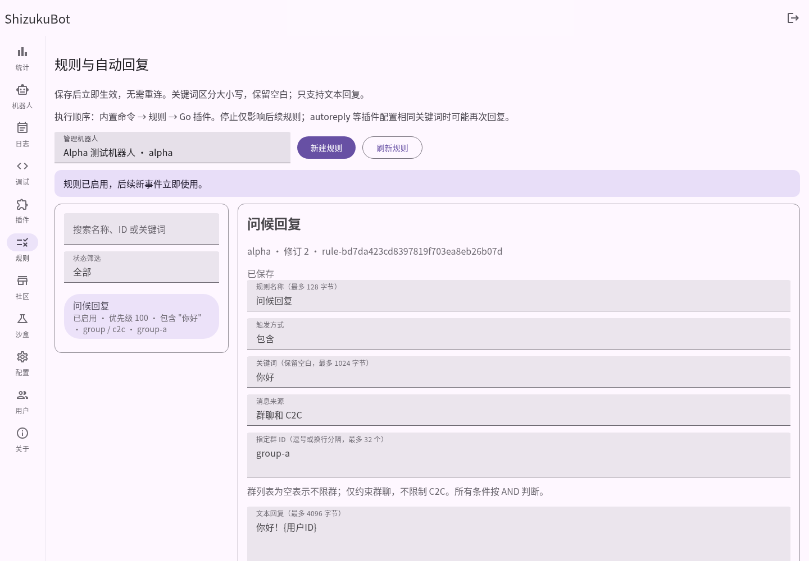
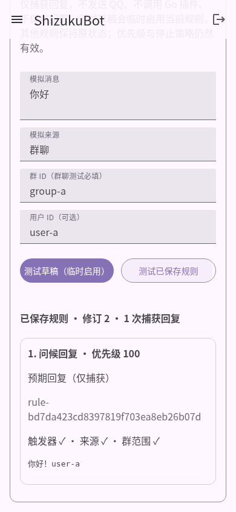

# P2.2 轻量规则与自动回复交付报告

## 基线与阶段提交

开始时工作区干净。fetch 了远程 main 和 `feat/v2-p2-plugin-ui`：main 为 `9cf1e69`，尚未包含 P2.1，因此从远程 P2.1 `f1f1d21` 创建 **`feat/v2-p2-rules`**。保留所有原提交，未重置 main、未删除或覆盖用户数据，交付仅推送该独立分支。

| 阶段 | 提交 | 内容 |
| --- | --- | --- |
| A | `253bcca` | 有界规则模型、校验、字面匹配、稳定排序与纯评估 |
| B | `3174aa9` | EventBus 单订阅、按 Bot 原子快照、版本化存储及并发测试 |
| C | `85184d7` | 真实 Bot 范围管理、原子 CRUD、捕获式测试 API 与权限回归 |
| D | `f04c0fb` | MDUI 2 规则管理、草稿、测试、修订冲突与生命周期保护 |
| E | 本报告所在提交 | 占位符分配边界、浏览器发现的列表插槽修复、完整回归、指南和真实截图 |

署名使用 `kylin930 <linyiyang930@gmail.com>`，各阶段英文提交信息可通过 `git log f1f1d21..feat/v2-p2-rules` 查看。

## 检查结论与最小接入

实际审查 `events`、`core/bot.go`、`core/bot_manager.go`、内置命令、Router、插件管理器、autoreply、沙盒及现有 MDUI 页面。现有事件已具备传输无关的 Event/Reply，Dispatcher 按 Bot/平台消息身份去重；Bus 按订阅顺序同步广播，插件恢复后才增加实例订阅；核心保留纯 MatchesBuiltin 判断。因此不需要第二套 SDK 回调、去重、插件宿主或 Bus 优先级重写。

数据链路为 QQ Adapter → Bot → 现有 Dispatcher → EventBus → 规则匹配 → 现有 Event.Reply。`rules` 只依赖标准库和 `events`，不依赖 sdk.Call、plugins、QQ DTO 或旧图模型，没有新增第三方依赖。

Router 组合时先订阅核心，再 Attach 一个规则引擎，随后 Restore Go 插件。内置命令保留优先行为，规则和插件通过现有纯判断跳过；普通事件可由两者响应。stop_on_match 只作用于本次规则集，不消费 EventBus 事件或改变插件回复能力。autoreply 示例、配置及启用状态完全保留，不自动迁移；页面和指南提醒同关键词可能再次回复。

## 数据、匹配与执行

每个 Bot 一个 Set：`schema_version`、`bot_id`、`revision`、`rules`。规则包含 ID、名称、enabled、priority、trigger(type/value)、conditions(sources/group_ids)、action(type/text)、stop_on_match。ID 在 Bot 内唯一，跨 Bot 可相同。新建 UI 默认禁用、priority=100、stop_on_match=true。

支持 exact、contains、prefix，使用 Event.Message 原文，区分大小写并保留空白，不做 Unicode 归一化。只接收对应来源的 group_message/group_at_message/c2c_message。来源、触发器、群范围固定 AND；空群列表不限群，非空列表只约束群消息，C2C 不受群列表限制。

排序为 priority 降序，再按规则 ID 升序。禁用不匹配，成功发送后才检查停止策略；发送失败继续后续规则。最多 **3 次发送尝试**，失败也计数。Trace 明确报告未匹配、已禁用、回复失败、限制、已回复、因停止/内置命令跳过等事实，条件是否评估也有字段，不能把未评估误读为未匹配。

唯一动作 reply_text 通过事件的 Reply 发送。缺少能力、同步 panic、error、取消及超时均有处理；错误以通用类别返回，生产日志只记 Bot/规则 ID 和原因，不记录完整消息或 SDK 内部异常。失败不阻断其他 Bus 订阅。规则不发布新入站事件。

四个占位符 `{用户ID}`、`{群ID}`、`{BotID}`、`{消息内容}` 只做一次字面替换，未知符号原样保留。插入的消息不会递归解释。先计算展开长度再分配，超过 8192 字节或展开为空白均标为 limited，并允许后续小回复继续。

固定限额：每 Bot 100 条，名称 128 字节，关键词 1024 字节，模板 4096 字节，输入消息 65536 字节，32 个群 ID、单 ID 128 字节，priority -1000..1000，API 1 MiB、文件 2 MiB。ID 最多 64 个合法 ASCII 字符。执行默认 5 秒合作取消，不制造用于强杀处理器的遗留 goroutine。

## 在线持久化与生命周期

`data/rules/<sha256(BotID)>.json` 使用独立版本化文件与 os.Root，规则 ID 不进入路径。保存完整校验并复制规则，在对应 Bot 的写锁下比较 revision，写同目录独占临时文件、Sync/Close 后 Rename，提交成功才发布 atomic.Pointer。GET 返回深拷贝，调用者无法改动生效快照。

事件持有不可变旧快照，发送不持 store/全局/写锁；更新后新读取立即使用新版本。两个管理员基于同一 revision 写入只允许一个成功；不同 Bot 可独立写入。删除和禁用不取消已开始事件，但阻止后续新快照匹配。重启按需加载保存的规则。未知版本、损坏内容、非普通文件和范围错误均报错并保留，不静默生成空配置覆盖。

Close 取消引擎生命周期、移除唯一订阅、等待在途工作，再关闭目录描述符；Router.Close 同时关闭规则与插件。Bot 停止/重连不会重新注册规则订阅。文件系统失败测试真实关闭 scoped root，确认磁盘原文件及内存版本不变；管理 API 另以非普通目标路径验证失败反馈。未使用只在非 root 用户下才生效的权限模拟。

持久化是单程序 writer；不承诺共享目录多进程事务、外部热编辑、跨 Bot 事务或断电级耐久。没有目录 fsync；Go Rename 的非 Unix 原子性保证有限，Windows 当前只完成交叉构建。已访问 Bot 的缓存保留到 Engine 关闭，删除 Bot 不自动清理其规则文件。

## 管理 API 与测试隔离

| 方法 | 路径 | 行为 |
| --- | --- | --- |
| GET | `/api/bots/{id}/rules` | 返回版本化快照 |
| PUT | `/api/bots/{id}/rules` | `{revision,rules}` 整体替换；涵盖新建、编辑、启停及删除 |
| POST | `/api/bots/{id}/rules/test` | `{message,source,group_id,user_id,rules?}`，保存版本或显式草稿测试 |

全部验证真实 Bot、管理员、输入、请求限额，复用现有同源/CSRF 与返回 envelope。PUT 不接受 body 中跨 Bot 的 bot_id 等未知字段，强制 revision，空数组删除全部，冲突 `code:409` 带当前 revision。校验错误明确；存储内部错误不回传路径。规则保存不取得 Bot 生命周期锁，不重连 QQ。

Preview 与 Execute 共用 Match 和同一 evaluate 循环，仅将 sender 替换为捕获函数。不发布到 Bus、不调用生产插件、不读写插件状态、不保存草稿、不产生真实事件。API 使用草稿原本的 enabled；页面“测试草稿”明确临时启用当前规则副本，其他规则不变，便于先测试禁用的新规则。“测试已保存规则”不做此调整。结果中的 replied 只表示成功捕获，不代表真实 QQ 发送成功。

P2.1 插件沙盒和富媒体展示保持原样，没有为规则重写其调试语义。

## WebUI

增加独立 `/#/rules`，Rail 与 Drawer 各一个入口，保留原导航结构、主题和 MDUI 2。页面包括真实 Bot 选择、搜索、启用筛选、列表、编辑表单、删除确认、快速启停、保存、重置及测试条件/回复/停止跟踪。新 ID 使用浏览器 getRandomValues，避免依赖仅在安全上下文可用的 randomUUID。

中立 `AdminUI` 复用安全 DOM、请求、作用域、错误、未保存保护及操作锁定；PluginUI 保留兼容导出和自己的插件选择状态。规则拥有独立 Bot/草稿，不访问插件页内部状态。作用域销毁取消请求，加载版本拒绝迟到响应；保存时锁定交互，错误和冲突保留草稿，未加载数据不可提交。新建、编辑、切换 Bot/规则/页面、刷新与重置均处理未保存修改。

动态名称、条件、关键词、错误和预期回复使用 textContent/安全 DOM。真实浏览器将恶意 HTML 保存到真实 API 后再次加载和预览，确认不生成 img/script、不执行事件属性。截图检查发现 MDUI 标题使用默认插槽，已修复并补断言，列表显示名称及三行元信息，没有忽略页面异常。

## 实际测试结果

环境为 Linux amd64，Go 1.26.10。先运行 rules 的定向及 race、API 规则定向和全部 api/rules 测试，再运行全量检查；失败的初始编译（未使用导入）和浏览器定位歧义均修正后重新验证。测试未使用真实 QQ 凭证。

| 检查 | 实际结果 |
| --- | --- |
| `go test -json ./...` | **98 项顶层测试通过，0 失败、0 测试跳过**；包含原有 80 项及新增 rules 13、API 5 项 |
| `go test -race -json ./...` | **98 项通过，无 race 报告** |
| `go vet ./...` | 通过 |
| `go build ./...` | 通过，Linux |
| `GOOS=windows GOARCH=amd64 go build ./...` | 通过；未宣称 Windows 实机执行 |
| `go test ./rules` / `go test -race ./rules` | 定向通过；后续占位符分配/空展开边界纳入最终全量及 race |
| `go test ./api -run TestRules` / `go test ./api ./rules` | 真实 Bot、CRUD、冲突、即时启停、输入/配额、预览隔离、内置命令、插件共存、失败隔离、权限及 CSRF 通过 |
| 原 P0/P1/P1.2/P2.1 | 原测试保留，通过；去重、多 Bot、生命周期、配置状态、SDK、迁移、安全及沙盒没有删除断言 |
| 新规则 Chromium | 实际 MDUI CDN，1440×1000 / 390×844；创建、编辑、删除/取消、启停、搜索筛选、Bot 隔离、草稿/保存测试、未保存保护、真实修订冲突、迟到响应、已保存恶意文本均通过 |
| 原 P2.1 Chromium | 原脚本未改，插件配置/JSON 往返、实例启停、Bot/选择策略、沙盒及六种回复、安全夹具均通过 |
| 两套浏览器断言 | 无横向溢出、无未处理页面错误；另测保存失败、403、空数据展示，不用失败夹具截图伪造实际运行 |
| 原 HTTP 冒烟 | 真实启动、登录、静态文件、脱敏、退役路由、SIGTERM 退出通过；10 并发 **100 请求成功、0 失败** |
| Python 语法 / 格式 | 新浏览器脚本 py_compile、Go gofmt、git diff --check 通过；JS 由真实 Chromium 解析执行，无 Node 依赖 |

机器可读日志位于本机会话 `/tmp/shizuku-p22-test.json`、`/tmp/shizuku-p22-race.json`。没有测试文件的包由 go test 报 `[no test files]`，不计作测试跳过。新测试覆盖字面/空白/大小写、非法模型、来源/群范围、多 Bot、稳定优先级、停止、回复失败/缺失/panic/超时、三次限制、禁用删除、即时更新、重启、原子失败、并发保存与旧快照、深拷贝、原 Dispatcher 去重、关闭取消及取消订阅、占位符边界等。

复现：

```sh
go test ./...
go test -race ./...
go vet ./...
go build ./...
GOOS=windows GOARCH=amd64 go build ./...
go build -o /tmp/shizukubot-p22 .
# 可选测试工具：Python Playwright、Chromium；不是产品构建/运行依赖。
python3 scripts/p22-browser-smoke.py --binary /tmp/shizukubot-p22
python3 scripts/p2-browser-smoke.py --binary /tmp/shizukubot-p22
go build -o /tmp/shizuku-p22-http ./cmd/concurrency-test
python3 scripts/p0-smoke.py --binary /tmp/shizukubot-p22 --runner /tmp/shizuku-p22-http
```

浏览器/HTTP 冒烟使用隔离临时目录、禁用连接的 mock Bot、随机本机管理员密码。测试数据和凭据不提交；截图只有实际主程序/API 返回，后续合成错误展示夹具单独运行。

## 真实截图

截图来自 Chromium 实际运行，手机为视口测试，图中 ID 是临时测试值，不是生产 QQ 连接；保持原页面滚动布局，概览与测试结果分开拍摄。

- [桌面概览](images/p2-2/desktop-rules.png) / [桌面测试结果](images/p2-2/desktop-rule-test.png)
- [手机概览](images/p2-2/mobile-rules.png) / [手机测试结果](images/p2-2/mobile-rule-test.png)





## 兼容性、未实现与风险

- 保留 Go SDK/Manifest/Registry、Go 示例、Bot 配置/连接、日志统计、插件存储/状态/备份、旧图迁移原始数据及 P2.1 沙盒。仅创建独立规则目录，未扫描或迁移 autoreply 私有数据。
- 没有新增 Node/npm/JS/TS 后端运行时、解释器、LiteGraph、动态编译、热加载或插件生命周期管理器；普通浏览器 JavaScript 和 MDUI CDN 是原前端体系。
- 正则、冷却、用户白名单、任意条件树、定时/工作流、HTTP/Shell/文件/数据库动作、市场与在线安装均未实现。前三种字面匹配和文本回复为本轮边界。
- 未连接真实 QQ、验证生产 HTTPS/平台权限/限频/媒体或实际手机、Windows 运行。平台回复能力使用 mock；截图中的“捕获成功”不能证明平台发送成功。
- Go 插件仍是可信同进程代码，规则/沙盒不提供 OS 隔离。超时与关闭是合作取消，不合作的 sender/插件可阻塞相应调用；没有声称强制终止。
- 规则与插件可能同时回复；规则三次上限不限制其他插件。没有自动协调关键词或隐式禁用 autoreply。
- 单进程存储，Windows Rename/断电耐久和多进程共享目录的限制见前文；未知文件需管理员离线处理，不能通过“刷新”强制覆盖。已开始事件可能按旧快照回复。
- CAS 防止覆盖，但不实现可视化差异/自动合并；发生冲突时复制草稿再刷新。规则生产错误使用现有日志，无完整 RBAC 或新观测平台。

下一步若确有需求，可在现有边界内增加配置差异合并、规则错误摘要，以及有界冷却/Go RE2 正则；先补充真实 QQ 与 Windows 文件系统集成验证，不预建工作流或脚本平台。日常操作与完整数据/API 语义见 [规则指南](rules-guide.md)。
